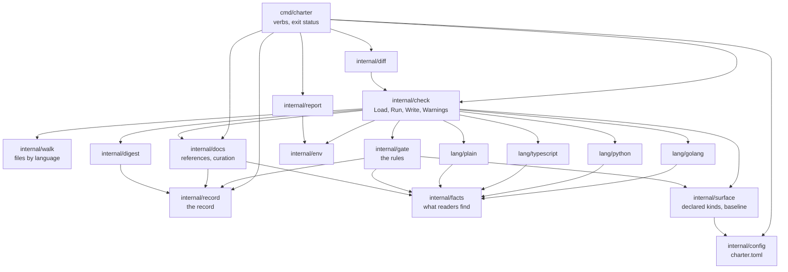

# Architecture

Charter is one Go binary, `charter`, built from `cmd/charter` and the
packages under `internal/`. It reads a charter (the record in `claims/`,
the configuration in `claims/charter.toml` and the source tree around
them), and it writes only the files `charter gen` generates, the docs'
references, a curation block and, on request, the baseline. This doc is
for someone about to change that code: the parts, what crosses between
them, the processes the command starts, and where to begin for each kind
of change. What each verb does with the data is in the walkthroughs:
[gen](gen.md), [check](check.md), [report](report.md), [diff](diff.md) and
[docs](docs.md).

## The packages

The graph has one hub. [check](../internal/check/check.go) is the only
package that knows every language: it walks the tree, hands each
language's files to that language's reader, collects the facts, and passes
them with the record to the rules. No package below it parses source:
they read the record and the facts, and `docs` reads a declaration's
lines only to hash them. `config`, `record`, `report` and `diff` are
also imported by the command directly, for the verbs that do not run the
gate.

## The command

[`run`](../cmd/charter/main.go#L47) finds the charter with
[`Find`](../internal/config/config.go#L128), then dispatches the verb: `check`,
`gen`, `next`, `anchors`, `questions`, `report`, `diff` or `curate`
([CH-040](../claims/anchoring.md#ch-040-one-charter-command-must-generate-check-give-ids-and-list-anchors-so-an-adopter-writes-no-main)). Its exit status is 0 for success, 1
when the verb found something (a gate problem, an unverified scenario, an
unrecorded change, a doc curate refused) and 2 when it could not run (no
charter, a bad argument, a reader that failed). `anchors` and `report`
print JSON; `report -md` prints markdown; the rest print lines.

The command has no configuration of its own beyond charter.toml and two
environment variables, both named in [env](../internal/env/env.go):
`CHARTER_EVENTS`, which the generated markers write to and the report sets
([CH-024](../claims/anchoring.md#ch-024-each-languages-verifies-must-record-each-citation-and-its-tests-outcome-as-a-json-line-in-the-events-file)), and `CHARTER_UPDATE_BASELINE`, which
makes check rewrite the baseline ([CH-033](../claims/gate.md#ch-033-the-gate-must-enumerate-every-surface-and-require-each-to-be-accounted-for-by-an-entry-or-listed-in-a-baseline-of-live-unaccounted-surfaces)). The gate
counts both as surfaces of this charter, and each is in the `Accounts:` of
the entry that owns it.

## Configuration

[`Config`](../internal/config/config.go#L70) is `claims/charter.toml` decoded
with BurntSushi/toml, with `Root` set to the directory holding `claims/`.
[`Parse`](../internal/config/config.go#L165) refuses an undecoded key, a value
of the wrong type, a language table without `test`, `[go]` without
`module`, `[typescript]` without `compiler` and a `[[files]]` table without
`patterns` or `comment`, each as `claims/charter.toml:N: ...`
([CH-261126-33GK](../claims/adoption.md#ch-261126-33gk-charter-must-find-claimschartertoml-by-walking-up-from-the-working-directory-and-must-refuse-a-key-it-does-not-know)). The line comes from a scan of
the source text that maps each table and dotted key to its first line,
because the decoder reports lines only for syntax errors. Every path in
the file is relative to the root.

## The record

[`Read`](../internal/record/record.go#L154) reads every `.md` file directly in
`claims/` except `README.md`, `questions.md`, `observations.md`,
`policy.md`, `glossary.md`, `audit.md` and the digest. Each file is an area
document, `needs.md` holding the needs; [`parseArea`](../internal/record/areas.go#L141)
turns it into an [`Area`](../internal/record/record.go#L99) and its
[`Entry`](../internal/record/record.go#L55) values
([CH-010](../claims/intent.md#ch-010-the-record-reader-must-read-an-entry-as-a-heading-with-id-and-title-then-field-lines-text-why-scenarios-guidance-and-changes-in-that-order), [CH-261126-JC9B](../claims/intent.md#ch-261126-jc9b-the-record-reader-must-treat-an-area-documents-header-as-a-title-a-code-line-and-prose-and-must-not-read-a-fenced-line-as-a-heading)).
Then `Read` parses `observations.md`, `questions.md`, `waivers.txt` and
`reading-order.txt` when they exist. The result is a
[`Record`](../internal/record/record.go#L117): areas, entries sorted by prefix
and then by id ([`Before`](../internal/record/ids.go#L75): numbered ids by
number, then dated ids by day and code), observations, questions, waivers,
the reading order, and every form problem as a string
`file:line: form: ...`.

The record package knows nothing of code. An entry's `Symbol` is its id
with each hyphen an underscore, which is the name every generated file
declares it by, and [`Record.BySymbol`](../internal/record/record.go#L142) maps a
symbol a reader found back to the entry or the observation it names.

## The walk

[`Walk`](../internal/walk/walk.go#L50) lists the files under the root by
language: `.go`, `.py`, and `.ts` and `.tsx` that are not `.d.ts`, for the
languages charter.toml names ([CH-036](../claims/gate.md#ch-036-the-walk-must-cover-every-go-python-and-typescript-file-under-the-root-skipping-another-charters-tree-and-what-chartertoml-ignores)). It skips
`.git`, `node_modules`, `vendor` and `testdata`; every directory whose name
begins with `.` or `_`; every `ignore` pattern, matched with `path.Match`
against the slash path and against the base name; everything outside
`only`; and every directory below the root that holds its own
`claims/charter.toml`. That last rule is the boundary between charters:
it is why this charter's gate never sees `examples/ratelimit` or
`examples/slugs`, and why nested Go modules are walked like any other
directory. A file in no language is listed under the first `[[files]]`
table whose patterns match it ([CH-261127-45KM](../claims/anchoring.md#ch-261127-45km-charter-must-read-an-anchor-from-a-comment-line-in-a-file-no-language-reads-where-chartertoml-names-that-file)).

## The readers and the facts

A reader turns one language's files into a
[`Set`](../internal/facts/facts.go#L105) of facts. Every fact carries its slash
path, relative to the root, and its line:

| Fact | What it is |
|---|---|
| [`Anchor`](../internal/facts/facts.go#L21) | a `charter:realizes` or `charter:concerns` directive, its ids and the declaration it sits on |
| [`Citation`](../internal/facts/facts.go#L35) | a `verifies` call opening a test (or `observes` opening a probe): the symbol, the handles, the test |
| [`Reference`](../internal/facts/facts.go#L48) | any other use of a generated symbol in a test file |
| [`EnvConst`](../internal/facts/facts.go#L55) | a string constant of a constants module: a variable the tree reads |
| [`EnvRead`](../internal/facts/facts.go#L65) | a read of the environment, through a constant, a literal or a variable, and whether its line carries `charter:dynamic` |
| [`Literal`](../internal/facts/facts.go#L75) | a string literal shaped like a variable's name, outside the constants modules and the tests |
| [`Refused`](../internal/facts/facts.go#L82) | a directive or call the reader would not count, with its `rule N` and message |
| [`Decl`](../internal/facts/facts.go#L92) | a production declaration a doc may name, with its first and last line |

Each reader decides what counts as an anchor or a citation in its
language, because that depends on syntax: a Go doc comment, a Python
comment block above a `def`, a TypeScript line comment, the first
statement of a `Test` function or a `test_` method
([CH-021](../claims/anchoring.md#ch-021-production-code-must-anchor-an-entry-in-a-go-doc-comment-a-typescript-line-comment-or-the-comment-lines-above-a-python-def), [CH-023](../claims/anchoring.md#ch-023-a-test-must-cite-an-entry-by-a-verifies-call-that-opens-a-test-function-naming-by-handle-the-scenarios-it-exercises)). What a
reader cannot count it reports as `Refused`, so the gate prints it like
any other problem.

- **Go.** [`Reader.Read`](../internal/lang/golang/reader.go#L52) parses each
  file with `go/parser` in process. `_test.go` files yield citations and
  references; other files yield anchors, declarations and either constants
  (in the package `[go].env` names) or environment reads. Files under
  `claims/` are the generated module and are not read.
- **Python.** [`Reader.Read`](../internal/lang/python/python.go#L54) runs
  `python3 -I -c` with the embedded `reader.py`, sends the files as JSON on
  standard input and decodes the facts from standard output. The script
  parses with the standard `ast` and `tokenize` modules alone. `-I` keeps
  the tree's own modules from shadowing the standard library the script
  imports. A file named `test_*.py`, `*_test.py` or `conftest.py` is a
  test.
- **TypeScript.** [`Reader.Read`](../internal/lang/typescript/typescript.go#L112)
  writes the embedded `reader.mjs` to a temporary directory and runs it
  with `node`, passing the adopter's typescript package directory
  (`[typescript].compiler`), the specifier tests import the claims by and
  the constants file. The script loads that compiler, prints `ready`, and
  answers one JSON line with per-file records; the Go side then decides
  which calls are citations. A file ending `.test.ts`, `.test.tsx`,
  `.spec.ts` or `.spec.tsx` is a test.
- **Plain files.** [`Reader.Read`](../internal/lang/plain/plain.go#L28) scans
  each line of a `[[files]]` file for the table's comment marker followed
  by `charter:realizes` or `charter:concerns`, and anchors the whole file.

A language charter.toml does not name is never walked and its parser is
never started ([CH-261126-PQ7X](../claims/adoption.md#ch-261126-pq7x-charter-must-support-each-language-as-a-built-in-reader-generator-and-marker-and-must-read-a-language-only-when-chartertoml-names-it)).

## Why the gate names no language

[gate](../internal/gate/gate.go) imports `facts`, `record` and `surface`
and nothing else of the tooling. [`Check`](../internal/gate/gate.go#L56) takes
an [`Input`](../internal/gate/gate.go#L26) (the record, the facts, and the
paths and patterns charter.toml gives) and returns sorted problem strings.
Because a rule sees an `Anchor` or a `Citation` and never a syntax tree, a
rule is written once and holds the same way in Go, Python and TypeScript,
and `same-rule-every-language` checks that the three report a missing
citation in the same words. The record says what this replaced: Go woven
through the gate, which made a second language a parallel path beside it.

<!-- charter:embed CH-261126-PQ7X -->
> **[CH-261126-PQ7X](../claims/adoption.md#ch-261126-pq7x-charter-must-support-each-language-as-a-built-in-reader-generator-and-marker-and-must-read-a-language-only-when-chartertoml-names-it) charter MUST support each language as a built-in reader, generator and marker, and MUST read a language only when charter.toml names it**
>
> - The charter supports Go, Python and TypeScript, each by three parts
>   built into the command: a reader that turns its source files into facts
>   (the anchors, citations, references, environment reads and refused
>   directives, with their files and lines); a generator that writes its
>   symbol file; and a marker, the `verifies` its tests call.
> - The gate's rules MUST read the facts alone and MUST NOT name a
>   language, so a rule holds the same way in each.
> - A language charter.toml does not name MUST NOT be read, and nothing it
>   needs is run.
> - Python is parsed by python3 with the standard `ast` module, and
>   TypeScript by the typescript package charter.toml names; a missing one
>   MUST fail naming that language's table.
> - Another language is a change to the charter, not a plug-in.
<!-- /charter:embed -->

The split puts syntax in the readers and policy in the gate. A reader may
refuse what it cannot read as a fact, such as a `Verifies` that another
statement precedes, but whether an anchor names an entry, whether a
scenario is cited and whether a surface is accounted for are decided in
`gate` alone.

## The rest of the core

- [surface](../internal/surface/surface.go) runs each `[[surface]]`
  command and reads and rewrites `claims/baseline.txt`
  ([CH-261126-NTRR](../claims/gate.md#ch-261126-ntrr-charter-check-must-read-a-declared-surface-kinds-keys-as-the-output-lines-of-a-command-run-from-the-root), [CH-033](../claims/gate.md#ch-033-the-gate-must-enumerate-every-surface-and-require-each-to-be-accounted-for-by-an-entry-or-listed-in-a-baseline-of-live-unaccounted-surfaces)).
- [docs](../internal/docs/docs.go) parses each doc's entry references,
  code references, embeds and curation block; resolves them against the
  record and a [`Code`](../internal/docs/docs.go#L271) index built from the
  readers' `Decl` facts; rewrites them for gen; and hashes, curates and
  names stale docs. It names no language either: a declaration is a fact
  ([docs](docs.md)).
- [digest](../internal/digest/digest.go) renders the record as one
  markdown document ([CH-261005-6ZBS](../claims/review.md#ch-261005-6zbs-charter-gen-must-write-a-digest-that-reads-the-charter-in-order-needs-by-area-an-area-map-then-each-areas-decisions-with-their-why)).
- [report](../internal/report/report.go) runs the test commands and joins
  the events to the scenarios ([report](report.md)).
- [diff](../internal/diff/diff.go) reads the area documents at a git
  revision and compares them with the current ones ([diff](diff.md)).

## The processes the command starts

The command reads the tree as data, except where it starts a process:

| Process | Started by | When |
|---|---|---|
| `python3 -I -c reader.py` | the Python reader | check, gen (docs), anchors, curate, diff, when `[python]` is set and there are Python files |
| `node reader.mjs` with the adopter's typescript package | the TypeScript reader | the same, for `[typescript]` |
| `sh -c` each `[[surface]]` command, from the root | [`Declared`](../internal/surface/surface.go#L29) | check |
| `sh -c` each language's `test` command, in its `dir` | [`report.Run`](../internal/report/report.go#L125) | report |
| `git ls-tree` and `git show` | [`diff.Diff`](../internal/diff/diff.go#L27) | diff |

The surface and test commands, and the typescript package the reader
loads, come from the repository under check. Running `charter check` or
`charter report` on a tree therefore runs that tree's code, as `go test`
or `make` would; it is no sandbox for an untrusted checkout.

## The charter's own charter

The tooling's decisions are the `CH` entries in `claims/`, and its own
gate must pass ([CH-006](../claims/adoption.md#ch-006-the-charter-must-specify-itself-and-its-own-gate-must-pass)). Each package's doc
comment, or the declaration that decides, carries `//charter:realizes CH-…`,
and the tests open with `claims.Verifies(t, claims.CH_…, "handle")`
against the generated module `github.com/leroux/charter/claims`. The six
skills are anchored too: `claims/charter.toml` names
`plugin/skills/*/SKILL.md` in a `[[files]]` table with the marker `#`, and
each skill's frontmatter holds `# charter:realizes CH-261126-5JMD`.

The examples hold the other side. In
[adopter_test.go](../cmd/charter/adopter_test.go),
`TestTheExamplesPassTheirOwnGate` runs `charter check` inside
`examples/ratelimit` and `examples/slugs`, and
`TestACopyMissingACitationFailsNamingTheScenario` breaks a copy of each
and expects the gate to name the scenario
([CH-261126-NS7T](../claims/needs.md#ch-261126-ns7t-an-adopter-must-be-able-to-keep-a-charter-in-any-repository-layout-and-language-with-code-that-imports-nothing-of-the-tooling)). The clean fixture, `fixture` in
[check_test.go](../internal/check/check_test.go), is a whole charter in one
map; `TestEveryRuleHasAMutationThatTripsIt` collects every `rule N` string
from the source of `gate`, `check`, `surface`, `lang/golang` and `docs`,
and fails for one no mutation of the fixture trips.

## Where to start

| To change | Start in | The entries | The tests |
|---|---|---|---|
| The entry form, ids, provenance, questions | [`parseArea`](../internal/record/areas.go#L141), [`ParseID`](../internal/record/ids.go#L44), [`parseProvenance`](../internal/record/areas.go#L103) | the intent and provenance areas | `internal/record` |
| What counts as an anchor or a citation in a language | that language's reader: [golang](../internal/lang/golang/reader.go), [reader.py](../internal/lang/python/reader.py), [reader.mjs](../internal/lang/typescript/reader.mjs) with [typescript](../internal/lang/typescript/typescript.go) | [CH-021](../claims/anchoring.md#ch-021-production-code-must-anchor-an-entry-in-a-go-doc-comment-a-typescript-line-comment-or-the-comment-lines-above-a-python-def), [CH-023](../claims/anchoring.md#ch-023-a-test-must-cite-an-entry-by-a-verifies-call-that-opens-a-test-function-naming-by-handle-the-scenarios-it-exercises), [CH-034](../claims/gate.md#ch-034-code-must-read-an-environment-variable-through-a-named-constant-or-under-a-dynamic-directive-and-a-literal-must-not-name-one) | `internal/lang/*` |
| A rule of the gate | a method of `checker` in [gate](../internal/gate/gate.go) | the gate area | a case in `internal/check`, and a mutation in `TestEveryRuleHasAMutationThatTripsIt` |
| What gen writes | [`Generated`](../internal/check/check.go#L216) and each language's `Generate` | [CH-020](../claims/anchoring.md#ch-020-charter-gen-must-generate-a-symbol-per-entry-in-each-language-read-named-by-the-id-with-underscores-for-hyphens-and-documented-by-the-title), [CH-261005-6ZBS](../claims/review.md#ch-261005-6zbs-charter-gen-must-write-a-digest-that-reads-the-charter-in-order-needs-by-area-an-area-map-then-each-areas-decisions-with-their-why) | `internal/lang/*`, `internal/digest` |
| Docs and curation | [docs](../internal/docs/docs.go) | [CH-261127-3NY3](../claims/anchoring.md#ch-261127-3ny3-a-doc-must-be-a-markdown-file-chartertoml-names-must-declare-no-entry-and-its-references-to-entries-must-resolve), [CH-261127-DW8R](../claims/anchoring.md#ch-261127-dw8r-a-doc-must-reference-code-by-a-link-to-the-file-that-declares-the-named-symbol-and-the-gate-must-fail-one-that-file-lacks), [CH-261127-H4B7](../claims/anchoring.md#ch-261127-h4b7-charter-gen-must-keep-each-docs-references-and-embeds-current-with-the-record-and-the-code), [CH-261127-GXP7](../claims/anchoring.md#ch-261127-gxp7-charter-curate-must-record-who-curated-a-doc-and-a-hash-of-each-reference-and-charter-check-must-warn-when-one-changes), [CH-261127-8MYR](../claims/anchoring.md#ch-261127-8myr-charter-must-compute-which-docs-mention-an-entry-from-the-docs-and-charter-anchors-and-charter-diff-must-show-it) | `cmd/charter/docs_test.go` |
| A verb's arguments or output | [`run`](../cmd/charter/main.go#L47) | [CH-040](../claims/anchoring.md#ch-040-one-charter-command-must-generate-check-give-ids-and-list-anchors-so-an-adopter-writes-no-main) | `cmd/charter/main_test.go` |
| charter.toml | [`Config`](../internal/config/config.go#L70), [`Parse`](../internal/config/config.go#L165) | [CH-261126-33GK](../claims/adoption.md#ch-261126-33gk-charter-must-find-claimschartertoml-by-walking-up-from-the-working-directory-and-must-refuse-a-key-it-does-not-know) | `internal/config` |

Whatever the change, it is a change to an entry first: its text, a
scenario and a dated `Changes:` line, as [the loop](loop.md) describes.
`go run ./cmd/charter diff origin/main` names one that has none, and `make
check` runs the Go tests, this charter's gate, and each example's gate and
report.

## Traps

- `check` imports every language reader, so it is not language-free; the
  rule that names no language is `gate`'s. A rule added in `check` or in a
  reader instead of in `gate` is a rule that holds in one language only.
- A rule string added in a package the mutation test does not scan, such
  as the Python or TypeScript reader, is not held to a mutation. The
  TypeScript reader's `rule 16` is one today.
- The Python and TypeScript readers run outside the process. A parse error
  in an adopter's file stops the whole read with `parse FILE:LINE: ...`,
  exit 2; it is no gate problem.
- A Go declaration's hash, which curation records, runs from its `func`,
  `type`, `var` or `const` keyword to its end. A change to its doc comment
  alone leaves every doc that references it current.
