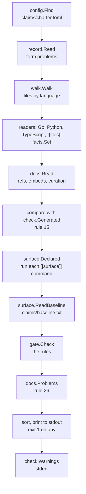

# What charter check does

`charter check` is the gate. It reads the record, walks the tree, has each
configured language's reader turn its files into facts, and holds the
record and the facts to the rules. It prints every problem on a line of
its own, sorted, to standard output, and exits 1 when it prints any; then
it prints its warnings to standard error, which never change the exit
status. A clean tree prints nothing to standard output and exits 0
([CH-037](../claims/gate.md#ch-037-charter-check-must-report-every-problem-sorted-with-its-file-line-rule-and-fix-and-must-pass-a-clean-tree), [CH-261127-QRQS](../claims/gate.md#ch-261127-qrqs-charter-check-must-warn-without-failing-of-a-planned-entry-fully-tested-a-deprecated-one-still-in-the-code-and-a-doc-to-read-again)). It is
static: it runs no test and writes no file, except the baseline when asked.
This doc follows one run from the command line to the printed lines.



## Finding the charter

[`Find`](../internal/config/config.go#L128) walks up from the working directory
to the first directory holding `claims/charter.toml`; that directory is
the root, and every path in the run is relative to it
([CH-261126-33GK](../claims/adoption.md#ch-261126-33gk-charter-must-find-claimschartertoml-by-walking-up-from-the-working-directory-and-must-refuse-a-key-it-does-not-know)). With none it fails, and so does
a configuration [`Parse`](../internal/config/config.go#L165) refuses; either
way `check` prints `charter: …` to standard error and exits 2, which is
distinct from the 1 a problem gives. A reader that cannot run (no
`python3`, no `node` or no typescript package where charter.toml names
one, a file that does not parse) is also exit 2, `charter check: …`.

## Reading the tree

[`Load`](../internal/check/check.go#L56) builds a
[`Tree`](../internal/check/check.go#L38):

1. **The record.** [`Read`](../internal/record/record.go#L154) parses the
   `.md` files of `claims/`, skipping the digest, and keeps every form
   problem: `claims/config.md:10: form: status "activ" is not planned,
   active or deprecated` ([gen](gen.md) follows the parser).
2. **The walk.** [`Walk`](../internal/walk/walk.go#L50) lists the files of each
   language charter.toml names, and the `[[files]]` files, skipping
   `.git`, `node_modules`, `vendor`, `testdata`, hidden and underscore
   directories, `ignore`, what lies outside `only`, and any directory
   holding another charter's `claims/charter.toml`
   ([CH-036](../claims/gate.md#ch-036-the-walk-must-cover-every-go-python-and-typescript-file-under-the-root-skipping-another-charters-tree-and-what-chartertoml-ignores)).
3. **The readers.** Go in process, Python through `python3 -I`, TypeScript
   through `node` and the adopter's typescript package, and the plain
   reader per `[[files]]` table; each returns a
   [`Set`](../internal/facts/facts.go#L105) of anchors, citations, references,
   environment constants, reads and literals, declarations and refused
   directives ([architecture](architecture.md#the-readers-and-the-facts)).
4. **The docs.** [`DocFiles`](../internal/check/check.go#L135) lists the
   markdown files the `docs` patterns match, by their own walk that
   `ignore` and `only` do not narrow, and
   [`Parse`](../internal/docs/docs.go#L151) reads each doc's references.

## Before the rules

[`Run`](../internal/check/check.go#L297) starts its list with the record's form
problems, then adds:

- **Generated files.** Every file `charter gen` would write is rendered
  and compared by bytes with the file on disk: missing or different is
  `rule 15`, naming `charter gen` ([CH-020](../claims/anchoring.md#ch-020-charter-gen-must-generate-a-symbol-per-entry-in-each-language-read-named-by-the-id-with-underscores-for-hyphens-and-documented-by-the-title)).
- **Environment patterns.** Each `env-patterns` value is compiled as a
  regular expression; one that is not is `rule 9` at its line in
  charter.toml.
- **Declared surfaces.** [`Declared`](../internal/surface/surface.go#L29)
  runs each `[[surface]]` table's `command` with `sh -c` from the root and
  takes each non-empty line it prints as a key, `kind:line`. A command
  that exits non-zero, a line printed twice, and a kind declared twice,
  named `env` or not a lower-case word are each `rule 9`
  ([CH-261126-NTRR](../claims/gate.md#ch-261126-ntrr-charter-check-must-read-a-declared-surface-kinds-keys-as-the-output-lines-of-a-command-run-from-the-root)).
- **The baseline.** [`ReadBaseline`](../internal/surface/surface.go#L86)
  reads `claims/baseline.txt`, a key, a tab and a reason a line; a line
  with no tab is `rule 7`. With `CHARTER_UPDATE_BASELINE` set, check first
  rewrites the file with every surface no entry accounts for, keeping the
  reasons it had and giving a new one `unclaimed at baseline init`
  ([`Rebuild`](../internal/surface/surface.go#L116)).

## The rules

[`Check`](../internal/gate/gate.go#L56) receives an
[`Input`](../internal/gate/gate.go#L26) of the record, the facts and the paths
charter.toml gives, and applies the rules in this order. Each problem is
`file:line: rule N: what is wrong and what to do`.

1. **What the readers refused.** Every `Refused` fact is printed as it
   came: a directive that documents no declaration, a `verifies` that is
   not its test's leading statement, a handle that is not a literal, a dot
   import of the claims package, an assignment to an entry
   ([CH-021](../claims/anchoring.md#ch-021-production-code-must-anchor-an-entry-in-a-go-doc-comment-a-typescript-line-comment-or-the-comment-lines-above-a-python-def), [CH-023](../claims/anchoring.md#ch-023-a-test-must-cite-an-entry-by-a-verifies-call-that-opens-a-test-function-naming-by-handle-the-scenarios-it-exercises),
   [CH-025](../claims/anchoring.md#ch-025-the-claims-directory-must-hold-only-the-record-chartertoml-and-generated-files-and-a-test-must-not-assign-to-an-entry)).
2. **Hand-written sources.** A source file under `claims/` that no
   generator writes is `rule 1` ([CH-025](../claims/anchoring.md#ch-025-the-claims-directory-must-hold-only-the-record-chartertoml-and-generated-files-and-a-test-must-not-assign-to-an-entry)).
3. **Anchors.** A directive naming an id that is no entry, or a planned
   entry, is `rule 24`; every other `realizes` marks its entries realized.
   A `concerns` anchor marks nothing ([CH-022](../claims/anchoring.md#ch-022-an-anchor-must-name-an-entry-that-exists-and-is-not-planned-and-a-concerns-anchor-must-not-count-toward-coverage)).
4. **Citations.** Each citation's symbol is resolved with
   [`Record.BySymbol`](../internal/record/record.go#L142). An `observes` must
   name an observation and come from a probe, a file under a `probes`
   path; a `verifies` must name an entry, must not come from a probe, and
   for a need must come from a `stakeholder-tests` file when that key is
   set; each handle must be one the entry lists. A citation that passes
   counts toward its entry ([CH-023](../claims/anchoring.md#ch-023-a-test-must-cite-an-entry-by-a-verifies-call-that-opens-a-test-function-naming-by-handle-the-scenarios-it-exercises),
   [CH-031](../claims/gate.md#ch-031-the-gate-must-not-ask-an-anchor-of-a-need-and-must-count-a-needs-citation-only-from-the-stakeholders-side), [CH-032](../claims/gate.md#ch-032-a-probe-must-cite-only-observations-and-a-test-must-not-cite-an-observation)). A reference
   to an observation outside a probe, or to an entry from a probe, is
   `rule 12`.
5. **Relations.** A `Serves` or `See` naming no entry, or the entry
   itself, and an observation's `Supports` naming no entry, are `rule 23`
   ([CH-015](../claims/intent.md#ch-015-the-gate-must-fail-a-serves-or-see-that-names-no-existing-entry-or-that-names-the-entry-itself)).
6. **Coverage.** For each active entry: a decision with no realizes anchor
   is `rule 25`, and no waiver absorbs it; each scenario no counted
   citation names is `rule 25` unless `claims/waivers.txt` holds
   `ID/handle`, a tab and a reason; an active entry without scenarios
   needs one citation of the entry. A waiver that is a glob, has no reason
   or absorbs nothing is `rule 25` ([CH-030](../claims/gate.md#ch-030-the-gate-must-fail-an-active-decision-without-an-anchor-or-with-an-uncited-scenario-a-waiver-may-absorb-a-missing-test-never-a-missing-anchor)).
7. **Observations.** Observations with no `probes` path in charter.toml
   are one `rule 11`. Each needs a `Subject`; an observed one an
   `Observed` date and a probe that cites it; a documented one a `Source`
   and no date. A broken observation supporting an active entry is
   `rule 13` ([CH-035](../claims/gate.md#ch-035-an-observation-must-carry-its-statuss-fields-and-the-gate-must-fail-a-broken-observation-under-an-active-entry)).
8. **The environment.** Outside the constants modules and the tests, a
   read of the environment (`os.Getenv` and `os.LookupEnv` in Go;
   `os.getenv`, `os.environ.get` and `os.environ[...]` in Python;
   `process.env` in TypeScript) must name a constant of a constants
   module, or its line must carry `charter:dynamic`. A read by a literal,
   by a variable, a literal equal to a declared variable's value, and a
   literal matching `env-patterns` are `rule 8`. A constants module
   charter.toml names that declares nothing is `rule 9`
   ([CH-034](../claims/gate.md#ch-034-code-must-read-an-environment-variable-through-a-named-constant-or-under-a-dynamic-directive-and-a-literal-must-not-name-one)).
9. **Surfaces.** [`Surfaces`](../internal/gate/gate.go#L367) collects every
   `env:NAME` from the constants and every declared key, and the live
   entry whose `Accounts:` names each; a deprecated entry owns nothing. A
   surface neither accounted for nor in the baseline is `rule 6`; an
   `Accounts` key nothing enumerates, and a baseline line listed twice,
   for a surface that is gone or now accounted for, is `rule 7`
   ([CH-033](../claims/gate.md#ch-033-the-gate-must-enumerate-every-surface-and-require-each-to-be-accounted-for-by-an-entry-or-listed-in-a-baseline-of-live-unaccounted-surfaces)).

Then [`Problems`](../internal/docs/docs.go#L313) adds `rule 26` for each doc
reference, embed or heading that does not resolve
([CH-261127-3NY3](../claims/anchoring.md#ch-261127-3ny3-a-doc-must-be-a-markdown-file-chartertoml-names-must-declare-no-entry-and-its-references-to-entries-must-resolve),
[CH-261127-DW8R](../claims/anchoring.md#ch-261127-dw8r-a-doc-must-reference-code-by-a-link-to-the-file-that-declares-the-named-symbol-and-the-gate-must-fail-one-that-file-lacks); [docs](docs.md)), and `Run` sorts
the whole list as strings.

<!-- charter:embed CH-030 -->
> **[CH-030](../claims/gate.md#ch-030-the-gate-must-fail-an-active-decision-without-an-anchor-or-with-an-uncited-scenario-a-waiver-may-absorb-a-missing-test-never-a-missing-anchor) The gate MUST fail an active decision without an anchor or with an uncited scenario; a waiver MAY absorb a missing test, never a missing anchor**
>
> - An active decision with no realizes anchor MUST fail, and a waiver
>   MUST NOT absorb it. That a concerns anchor does not count is CH-022's.
> - An active entry with scenarios MUST fail for each scenario no citation
>   names, naming the document, the line and the call to write; an active
>   entry without scenarios MUST fail when no citation names it at all.
> - The waiver file lists, one per line with a reason after a tab, an id or
>   a scenario as ID/handle, never a glob. A matching line absorbs the
>   missing test.
> - A waiver line that absorbs nothing, gives no reason or is a glob MUST
>   fail.
<!-- /charter:embed -->

## The rule labels

The `rule N` labels are the gate's own names for its rules; no entry
rules the numbers, and they are not consecutive. Each label and the
entries whose clauses it reports:

| Label | What it reports | Entries |
|---|---|---|
| `form:` | an area document, observation, question or reading order out of form | [CH-010](../claims/intent.md#ch-010-the-record-reader-must-read-an-entry-as-a-heading-with-id-and-title-then-field-lines-text-why-scenarios-guidance-and-changes-in-that-order), [CH-011](../claims/intent.md#ch-011-the-record-reader-must-treat-an-entry-of-needsmd-as-a-need-with-no-kind-serves-or-guidance), [CH-012](../claims/intent.md#ch-012-an-id-must-be-declared-once-and-a-new-id-must-be-its-prefix-the-day-it-was-taken-and-a-random-code), [CH-013](../claims/intent.md#ch-013-an-entrys-status-must-be-planned-active-or-deprecated-every-status-must-generate-a-symbol-and-the-gate-must-ask-coverage-of-active-entries-only), [CH-261126-HK6S](../claims/intent.md#ch-261126-hk6s-the-record-reader-must-read-an-observation-as-a-heading-in-observationsmd-with-its-subject-status-date-or-source-and-the-entries-it-supports), [CH-261009-VY5C](../claims/provenance.md#ch-261009-vy5c-the-record-reader-must-read-who-ruled-a-scenario-the-owner-with-what-it-cites-a-named-delegate-or-when-nothing-is-written-an-agent-provisionally), [CH-261009-4B3B](../claims/provenance.md#ch-261009-4b3b-the-question-file-must-hold-what-nobody-has-ruled-each-question-naming-its-entry-who-asked-and-the-provisional-answer-until-it-is-answered), [CH-261005-6ZBS](../claims/review.md#ch-261005-6zbs-charter-gen-must-write-a-digest-that-reads-the-charter-in-order-needs-by-area-an-area-map-then-each-areas-decisions-with-their-why) |
| `rule 1` | a hand-written source in `claims/`; an assignment to an entry | [CH-025](../claims/anchoring.md#ch-025-the-claims-directory-must-hold-only-the-record-chartertoml-and-generated-files-and-a-test-must-not-assign-to-an-entry) |
| `rule 6` | a surface no entry accounts for and no baseline line lists | [CH-033](../claims/gate.md#ch-033-the-gate-must-enumerate-every-surface-and-require-each-to-be-accounted-for-by-an-entry-or-listed-in-a-baseline-of-live-unaccounted-surfaces) |
| `rule 7` | an `Accounts` key nothing enumerates; a baseline line gone, accounted, twice or without a reason | [CH-033](../claims/gate.md#ch-033-the-gate-must-enumerate-every-surface-and-require-each-to-be-accounted-for-by-an-entry-or-listed-in-a-baseline-of-live-unaccounted-surfaces) |
| `rule 8` | an environment read not through a constant; a literal naming a variable | [CH-034](../claims/gate.md#ch-034-code-must-read-an-environment-variable-through-a-named-constant-or-under-a-dynamic-directive-and-a-literal-must-not-name-one) |
| `rule 9` | a bad `env-patterns` value, an empty constants module, a `[[surface]]` kind or command that fails | [CH-033](../claims/gate.md#ch-033-the-gate-must-enumerate-every-surface-and-require-each-to-be-accounted-for-by-an-entry-or-listed-in-a-baseline-of-live-unaccounted-surfaces), [CH-261126-NTRR](../claims/gate.md#ch-261126-ntrr-charter-check-must-read-a-declared-surface-kinds-keys-as-the-output-lines-of-a-command-run-from-the-root) |
| `rule 10` | a dot import (Go) or star import (Python) of the claims module | [CH-025](../claims/anchoring.md#ch-025-the-claims-directory-must-hold-only-the-record-chartertoml-and-generated-files-and-a-test-must-not-assign-to-an-entry) |
| `rule 11` | an observation missing its status's fields; observations with no probe path | [CH-035](../claims/gate.md#ch-035-an-observation-must-carry-its-statuss-fields-and-the-gate-must-fail-a-broken-observation-under-an-active-entry), [CH-032](../claims/gate.md#ch-032-a-probe-must-cite-only-observations-and-a-test-must-not-cite-an-observation) |
| `rule 12` | a probe citing an entry; a test citing an observation | [CH-032](../claims/gate.md#ch-032-a-probe-must-cite-only-observations-and-a-test-must-not-cite-an-observation) |
| `rule 13` | a broken observation under an active entry | [CH-035](../claims/gate.md#ch-035-an-observation-must-carry-its-statuss-fields-and-the-gate-must-fail-a-broken-observation-under-an-active-entry) |
| `rule 15` | a generated file missing or stale | [CH-020](../claims/anchoring.md#ch-020-charter-gen-must-generate-a-symbol-per-entry-in-each-language-read-named-by-the-id-with-underscores-for-hyphens-and-documented-by-the-title), [CH-261005-6ZBS](../claims/review.md#ch-261005-6zbs-charter-gen-must-write-a-digest-that-reads-the-charter-in-order-needs-by-area-an-area-map-then-each-areas-decisions-with-their-why) |
| `rule 16` | a TypeScript import of the claims module from production code, or in another form than `import { claims, verifies }` | none |
| `rule 23` | a `Serves`, `See` or `Supports` naming no entry, or itself | [CH-015](../claims/intent.md#ch-015-the-gate-must-fail-a-serves-or-see-that-names-no-existing-entry-or-that-names-the-entry-itself) |
| `rule 24` | an anchor or citation that names nothing, sits in the wrong place or names a planned entry; an unknown handle | [CH-021](../claims/anchoring.md#ch-021-production-code-must-anchor-an-entry-in-a-go-doc-comment-a-typescript-line-comment-or-the-comment-lines-above-a-python-def), [CH-261127-45KM](../claims/anchoring.md#ch-261127-45km-charter-must-read-an-anchor-from-a-comment-line-in-a-file-no-language-reads-where-chartertoml-names-that-file), [CH-022](../claims/anchoring.md#ch-022-an-anchor-must-name-an-entry-that-exists-and-is-not-planned-and-a-concerns-anchor-must-not-count-toward-coverage), [CH-023](../claims/anchoring.md#ch-023-a-test-must-cite-an-entry-by-a-verifies-call-that-opens-a-test-function-naming-by-handle-the-scenarios-it-exercises) |
| `rule 25` | coverage and waivers; a need cited from off the stakeholder's side | [CH-030](../claims/gate.md#ch-030-the-gate-must-fail-an-active-decision-without-an-anchor-or-with-an-uncited-scenario-a-waiver-may-absorb-a-missing-test-never-a-missing-anchor), [CH-031](../claims/gate.md#ch-031-the-gate-must-not-ask-an-anchor-of-a-need-and-must-count-a-needs-citation-only-from-the-stakeholders-side) |
| `rule 26` | a doc reference, embed or heading that does not resolve | [CH-261127-3NY3](../claims/anchoring.md#ch-261127-3ny3-a-doc-must-be-a-markdown-file-chartertoml-names-must-declare-no-entry-and-its-references-to-entries-must-resolve), [CH-261127-DW8R](../claims/anchoring.md#ch-261127-dw8r-a-doc-must-reference-code-by-a-link-to-the-file-that-declares-the-named-symbol-and-the-gate-must-fail-one-that-file-lacks) |

## What it prints

A copy of `examples/ratelimit` with three edits (a `t.Log` inserted
before the `Verifies` of `starts-full`, in `limiter/limiter_test.go`; the
anchor in `limiter/clock.go` changed to name `SW-261126-2XG9`, an id no
entry holds; and a constant `Extra = "RATELIMIT_EXTRA"` added to
`env/env.go`) prints:

```text
claims/limiter.md:29: rule 25: scenario starts-full of SW-261126-VX8Z is verified by no test; cite it with verifies(claims.SW_261126_VX8Z, "starts-full") as a test's first statement, or waive SW-261126-VX8Z/starts-full in claims/waivers.txt with a reason
claims/limiter.md:67: rule 25: active entry SW-261126-2XG8 is realized by no code; add charter:realizes SW-261126-2XG8 where it is implemented
limiter/clock.go:8: rule 24: charter:realizes names SW-261126-2XG9, which is not an entry of the record
limiter/limiter_test.go:40: rule 24: Verifies is the leading statement of its test, before anything runs, skips or branches; here something precedes or encloses it
rule 6: env:RATELIMIT_EXTRA is neither accounted for by an entry nor listed in claims/baseline.txt
```

and exits 1. The first two edits each show twice, because a refused
citation and an anchor naming no entry count for nothing: the misplaced
call is `rule 24` where it sits and `rule 25` at the scenario it no longer
covers, and the mistyped anchor is `rule 24` at `clock.go` and `rule 25`
at the decision it no longer realizes.

## The warnings

After the problems, [`Warnings`](../internal/check/check.go#L390) writes to
standard error, each with its file and line
([CH-261127-QRQS](../claims/gate.md#ch-261127-qrqs-charter-check-must-warn-without-failing-of-a-planned-entry-fully-tested-a-deprecated-one-still-in-the-code-and-a-doc-to-read-again)):

- `…: warning: SW-… is planned and each of its scenarios is verified; set
  it active`, at the entry's heading;
- `…: warning: SW-… is deprecated and still verified here; strip it before
  the entry is deleted`, and the same for `still anchored here`, at each
  citation and anchor;
- for each doc, `docs/X.md:1: warning: the doc is drafted: …` when it has
  no curation block, or `docs/X.md:N: warning: the doc is stale: ID changed
  since it was curated on DATE; …` for each reference whose hash differs
  from the one recorded ([docs](docs.md)).

A tree whose only findings are warnings exits 0 with nothing on standard
output, so a script that reads standard output sees a clean tree.

## Traps

- `rule 6` is the one problem with no file or line: a surface has no
  single place. It sorts after the problems that open with a path.
- Problems are sorted as strings, so `docs/a.md:11` prints before
  `docs/a.md:3`. Read the list as a set, not in line order.
- A citation the reader refused never reaches the handle check, so a
  misplaced call with a mistyped handle reports the placement alone.
- A read of the environment is a call of the reader function. Code that
  passes `os.Getenv` as a value, as `examples/ratelimit` does into its
  `run`, reads through a variable the reader never sees; only the
  literal check, by `env-patterns`, still applies to it.
- A Go anchor goes on the doc comment's last line, `//charter:realizes
  ID`, with or without a space after the slashes. Inside a function body,
  or on a comment parted from its declaration, it is refused and counts
  for nothing.
- A need has no anchor; the gate asks only a citation of it.
- The docs' patterns ignore `ignore` and `only`, so a doc under an
  ignored directory is still read, and a directory beginning with `.` or
  `_` never is.
