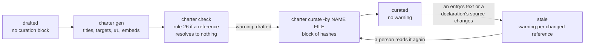

# Docs, curation and staleness

A doc is the prose a newcomer reads first: how the system works, why it
is shaped so, and the decisions each part carries. The record holds what
binds; a doc tells the story that joins it, and its prose is held to
nothing. What the gate checks are a doc's references: every link to an
entry must name one that exists and is not deprecated, every link to code
must name a declaration the file has, and once a person has read the doc,
check warns when anything it references has changed since. This doc
follows one doc from its first draft to a warning that it is stale. Every
doc in this directory is one.



## Which files are docs

A doc is a markdown file that one of charter.toml's `docs` patterns
matches; nothing else is read as one
([CH-261127-3NY3](../claims/anchoring.md#ch-261127-3ny3-a-doc-must-be-a-markdown-file-chartertoml-names-must-declare-no-entry-and-its-references-to-entries-must-resolve)). The patterns are matched with
`path.Match` against the slash path from the root and against the base
name, so `docs/*.md` matches one level and `*` never crosses a `/`; this
charter names `docs = ["docs/*.md"]`. [`DocFiles`](../internal/check/check.go#L135)
lists them by a walk of their own, which `ignore` and `only` do not narrow
and which, like every walk, skips directories whose names begin with `.`
or `_` and stops at another charter's root. A matched file that does not
end in `.md` is not a doc.

<!-- charter:embed CH-261127-3NY3 -->
> **[CH-261127-3NY3](../claims/anchoring.md#ch-261127-3ny3-a-doc-must-be-a-markdown-file-chartertoml-names-must-declare-no-entry-and-its-references-to-entries-must-resolve) A doc MUST be a markdown file charter.toml names, MUST declare no entry, and its references to entries MUST resolve**
>
> - A doc is a markdown file that charter.toml's doc patterns match,
>   matched as the ignore patterns are; charter MUST NOT read any other file
>   as a doc.
> - A doc tells a story over the record and the code, and its prose is
>   held to nothing.
> - A doc references an entry by a markdown link whose text opens with the
>   entry's id, and embeds one between a `charter:embed ID` comment and its
>   closing `/charter:embed` comment.
> - A reference or an embed naming no entry, or a deprecated one, MUST fail
>   naming the doc and the line.
> - A heading in a doc that opens with an id MUST fail, naming the area
>   documents as where entries are declared.
<!-- /charter:embed -->

## The references

[`Parse`](../internal/docs/docs.go#L151) reads each line of a doc for markdown
links, `[text](target)` on one line, and sorts each by its text:

- **An entry reference** is a link whose text opens with an id,
  `[CH-030](../claims/gate.md)` or `[CH-030 anything](…)`. The id must
  name an entry of the record that is not deprecated.
- **An embed** is `<!-- charter:embed CH-030 -->` and
  `<!-- /charter:embed -->`, each on a line of its own, and gen writes the
  entry between them. A line between them is never read for references.
- **A code reference** is a link whose text is a name in backticks, bare
  or dotted (``[`Check`](../internal/gate/gate.go)``,
  ``[`gate.Check`](…)``, ``[`Record.BySymbol`](…)``), and whose target is
  a file under the root ([CH-261127-DW8R](../claims/anchoring.md#ch-261127-dw8r-a-doc-must-reference-code-by-a-link-to-the-file-that-declares-the-named-symbol-and-the-gate-must-fail-one-that-file-lacks)).
- **Anything else** is prose: a link whose text is neither, a URL, a
  target that is only a fragment, a target outside the root, and anything
  in a fenced or indented code block or a code span.

A heading that opens with an id is refused: a doc declares no entry, so a
reader by program finds every entry in the area documents.

### How a code reference resolves

[`Code.Resolve`](../internal/docs/docs.go#L296) looks the name up among the
`Decl` facts the readers found in the target file: a Go function, method,
type, var or const at the top level; a Python `def` or `class`, nested ones
by their dotted path; a TypeScript declaration. A method's name is its
type's and its own, `Record.BySymbol`, with a pointer receiver's `*`
dropped. The name may also be qualified by the package, the Go package
clause or, in Python and TypeScript, the file's name without its
extension: `gate.Check`, `check.Load`.

A target that no language reads (a markdown file, a shell script, a file
of a language charter.toml does not name, a file the walk skipped) only
has to exist as a file. The same holds for a file of another charter, so
this charter's docs can link `examples/ratelimit/limiter/limiter.go` but
only by its existence.

### What fails

Each failure is `rule 26`, at the doc's line
([`Problems`](../internal/docs/docs.go#L313)). A doc in a copy of
`examples/ratelimit`, with `SW-261126-2XG8` set deprecated, holding a
reference to `SW-999` (line 3) and to `SW-261126-2XG8` (5), a code
reference ``[`gate`](../limiter/limiter.go)`` (7), one to
`../limiter/nope.go` (9), a heading `## SW-261126-VX8Z again` (11) and an
embed with no closing comment (13), prints, sorted as strings:

```text
docs/a.md:11: rule 26: a doc declares no entry; this heading opens with an id; write the entry in an area document under claims and reference it here
docs/a.md:13: rule 26: the embed of SW-261126-VX8Z has no closing <!-- /charter:embed --> comment
docs/a.md:3: rule 26: the reference names SW-999, which is not an entry of the record
docs/a.md:5: rule 26: the reference names SW-261126-2XG8, which is deprecated; name what replaces it, or drop the reference
docs/a.md:7: rule 26: limiter/limiter.go declares no gate; name a function, type, class, method or constant it declares, or point the link at the file that does
docs/a.md:9: rule 26: the code reference to limiter/nope.go names a file that is not there
```

## What gen keeps current

[`Rewrite`](../internal/docs/docs.go#L386), run by `charter gen`, rewrites each
entry reference's target to the entry's heading in its area document and
its text to `ID: Title` (a bare id stays bare); each code reference's
target to the file with `#L` and the declaration's first line; and each
embed's body to the entry's id, title and text as a quote. It changes
nothing else, and writes a doc only when its text changed
([CH-261127-H4B7](../claims/anchoring.md#ch-261127-h4b7-charter-gen-must-keep-each-docs-references-and-embeds-current-with-the-record-and-the-code); [gen](gen.md#docs)). A
reference that does not resolve is left as written.

## Curation

`charter curate -by NAME FILE...` records that a person read each doc
against the record and the code ([CH-261127-GXP7](../claims/anchoring.md#ch-261127-gxp7-charter-curate-must-record-who-curated-a-doc-and-a-hash-of-each-reference-and-charter-check-must-warn-when-one-changes);
[`curate`](../cmd/charter/main.go#L310)). `-by` defaults to `owner`. For each
file it:

1. resolves the path from the working directory to the root, and refuses
   a file the `docs` patterns do not name;
2. runs `rule 26` over that doc alone, and on any problem prints it with
   `… has references that do not resolve; nothing written` and writes
   nothing;
3. hashes every entry the doc references or embeds and every code
   reference ([`Hashes`](../internal/docs/docs.go#L485));
4. replaces the curation block at the doc's end, or appends one after a
   blank line, and changes no byte before it
   ([`Curate`](../internal/docs/docs.go#L525)).

The block is an HTML comment, invisible where markdown renders:

```text
<!-- charter:curated
by: owner
date: 2026-11-27
SW-261126-VX8Z f5e0ba82ae942577
limiter/limiter.go#Limiter.Allow f25c00572fc8ef71
-->
```

Each key is an entry id or `file#Name`; each value is the first 16 hex
digits of a SHA-256 over the referenced text with its whitespace
normalized to single spaces ([`Hash`](../internal/docs/docs.go#L446)):

- an entry, over its title, its status and its text
  ([`EntryHash`](../internal/docs/docs.go#L455)), so a new Changes line alone
  does not change it, and neither does its Why;
- a declaration, over its lines from the first to the last as the reader
  found them ([`Code.CodeHash`](../internal/docs/docs.go#L463));
- a file no language reads, over the whole file.

The record says why a hash and not a date: a curation date compared
against git history needs that history intact, which a shallow clone or a
squashed merge loses, while a hash travels with the doc and changes only
when the referenced text does.

## Staleness

Every check run computes the doc's hashes again and
[`Stale`](../internal/docs/docs.go#L567) compares them with the block:

- no block: `docs/X.md:1: warning: the doc is drafted: no one has curated
  it; read it against the record and the code, then run charter curate
  docs/X.md`;
- a recorded hash that differs: `docs/X.md:N: warning: the doc is stale:
  KEY changed since it was curated on DATE; …`, at the reference's line;
- a reference added since: `… KEY is referenced since it was curated on
  DATE; …`.

These are warnings on standard error; they never fail check
([CH-261127-QRQS](../claims/gate.md#ch-261127-qrqs-charter-check-must-warn-without-failing-of-a-planned-entry-fully-tested-a-deprecated-one-still-in-the-code-and-a-doc-to-read-again)). The warning says what changed, not
whether the prose is still true; that is the person's to decide when they
read it again and curate it. The claims-narrate skill, asked about a
stale doc, proposes an edit of the sentences around each changed
reference and never curates.

## Who mentions an entry

Nobody writes a backlink. `charter anchors ID` lists, under `docs`, each
doc and line that references or embeds the entry, read from the docs
themselves, and `charter diff REV` lists after its findings each doc whose
references changed since the revision ([CH-261127-8MYR](../claims/anchoring.md#ch-261127-8myr-charter-must-compute-which-docs-mention-an-entry-from-the-docs-and-charter-anchors-and-charter-diff-must-show-it);
[diff](diff.md#the-docs-to-read-again)).

## Traps

- A link whose text is a file name in backticks, such as
  ``[`derive.py`](derive.py)``, is a code reference to a declaration
  `py` in a package `derive`, and fails in a file a language reads. Write
  a file link without backticks: `[derive.py](derive.py)`.
- A link whose text opens with a question id, `Q-261127-TW9H`, is read as
  an entry reference and fails, since a question is not an entry. Name a
  question in a code span or in plain text.
- A test function cannot be referenced by name: the readers record the
  declarations of production files only. Link the test file and name the
  test in a code span.
- gen rewrites targets and adds `#L` anchors after you write a doc, so
  read a file again before editing it, and match its text without the
  anchors.
- A declaration's hash starts at its keyword, so a change to its doc
  comment alone leaves the doc current, and check does not compare a doc
  with gen's rewrite, so a title out of date passes until gen runs.
- An embed with no closing comment hides the rest of the doc: every line
  after its opening comment is read as its body, so references below it
  are never checked; the missing closing comment is the one problem the
  gate prints for those lines.
- `docs/**/*.md` matches only `docs/X/Y.md`: `**` is two `*` to
  `path.Match`, each within one path element.
