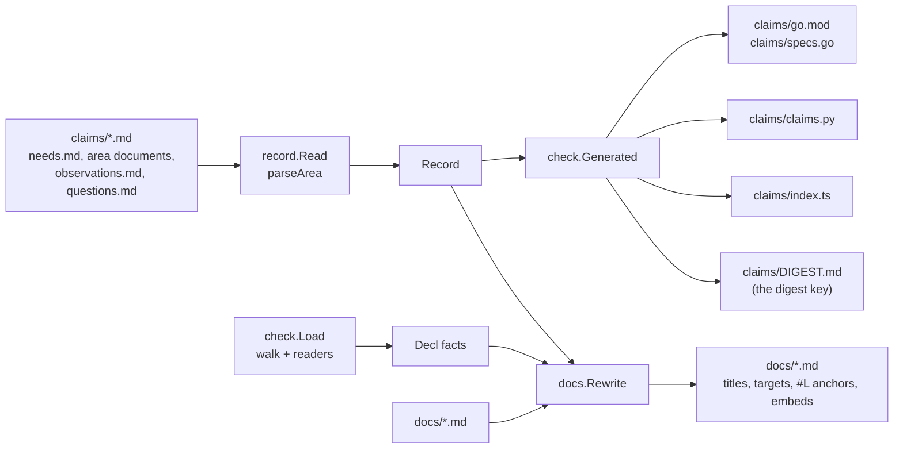

# What charter gen reads and writes

`charter gen` is the one writer of every generated file. It reads the
record's markdown and writes, into `claims/`, a symbol file for each
language charter.toml names and the digest when one is named. When
charter.toml names docs, it then rewrites each doc's references and embeds
to match the record and the code. This doc follows that data from the
area documents to the files on disk. The parts it passes through are
described once in [the architecture](architecture.md).

## Reading the record

[`run`](../cmd/charter/main.go#L47) hands `gen` to
[`Write`](../internal/check/check.go#L243), which reads the record with
[`Read`](../internal/record/record.go#L154) and nothing else: no source file is
parsed before the generated files are written. That is what lets gen run
when a generated file is missing or stale, which is exactly when a Go
build that imports the claims module would fail
([CH-040](../claims/anchoring.md#ch-040-one-charter-command-must-generate-check-give-ids-and-list-anchors-so-an-adopter-writes-no-main)).

`Read` lists every `.md` file directly in `claims/`, skips the ones that
are not area documents (`README.md`, `questions.md`, `observations.md`,
`policy.md`, `glossary.md`, `audit.md` and the digest itself), and parses
each with [`parseArea`](../internal/record/areas.go#L141):

- Before the first `## ` heading is the header: a `# Title`, an optional
  `Code:` line naming the packages the area covers, and prose that is kept
  but not parsed. A heading of any other level there is a form problem
  ([CH-261126-JC9B](../claims/intent.md#ch-261126-jc9b-the-record-reader-must-treat-an-area-documents-header-as-a-title-a-code-line-and-prose-and-must-not-read-a-fenced-line-as-a-heading)).
- Each `## ID Title` heading opens an entry. The id is held to
  [`ParseID`](../internal/record/ids.go#L44): a prefix and a number, `CH-001`,
  or a prefix, a `YYMMDD` day and four characters of the code alphabet,
  `CH-261127-3NY3` ([CH-012](../claims/intent.md#ch-012-an-id-must-be-declared-once-and-a-new-id-must-be-its-prefix-the-day-it-was-taken-and-a-random-code)).
- The lines after the heading, up to a blank line, are fields: `Status`,
  `Kind`, `Serves`, `See`, `Accounts`, each once
  ([`Entry.setField`](../internal/record/areas.go#L297)).
- The body is paragraphs: the text, then `Why:`, `Scenarios:`,
  `Guidance:` and `Changes:` in that order
  ([`parseBody`](../internal/record/areas.go#L347)). A scenario is "N.
  `handle` (provenance): sentence"; a change is "- YYYY-MM-DD: text"; a
  line indented under either continues it.
- A line inside a fenced block is text, never a heading, so an example
  entry in a fence stays an example.

Every departure is a string `claims/FILE:LINE: form: …` in
`Record.Problems`. gen writes anyway; check prints them. The entries are
then sorted by prefix, numbered ids by number before dated ids by day and
code ([`Before`](../internal/record/ids.go#L75)), and a second declaration of
an id is a form problem naming both files.

<!-- charter:embed CH-020 -->
> **[CH-020](../claims/anchoring.md#ch-020-charter-gen-must-generate-a-symbol-per-entry-in-each-language-read-named-by-the-id-with-underscores-for-hyphens-and-documented-by-the-title) charter gen MUST generate a symbol per entry in each language read, named by the id with underscores for hyphens and documented by the title**
>
> - For each language charter.toml names, `charter gen` MUST write one file
>   in the claims directory declaring a symbol per entry of any status,
>   named by the id with each hyphen as an underscore, holding the id, the
>   title, the status and the kind, with the title as its doc comment.
> - A planned entry MUST be marked planned, and a deprecated one MUST carry
>   a deprecation notice naming its document.
> - Each file MUST be self-contained: it declares the types, the `verifies`
>   and the `observes` it offers, and imports nothing outside its
>   language's standard library. For Go the file is specs.go in a module of
>   its own whose go.mod requires nothing; for TypeScript, index.ts; for
>   Python, claims.py.
> - The order the files declare the entries in is CH-012's.
> - `charter check` MUST fail a file that differs from its rendering, or is
>   missing, naming `charter gen`, and MUST NOT write one.
<!-- /charter:embed -->

## The symbol files

[`Generated`](../internal/check/check.go#L216) renders every generated file as
a map from its slash path under the root to its bytes, for the languages
charter.toml names. Each file declares one symbol per entry of any status,
named by [`Symbol`](../internal/record/areas.go#L40) (the id with each hyphen an
underscore: `CH-261127-3NY3` is `CH_261127_3NY3`), and one per
observation by its name. Each holds the marker a test calls, and imports
nothing outside its language's standard library.

| Language | File | An entry is | The marker |
|---|---|---|---|
| Go | `claims/go.mod`, `claims/specs.go` | `var CH_001 = &Spec{ID: "CH-001", Title: "…", Status: Active}` with the title as its doc comment | `Verifies(tb testing.TB, spec *Spec, handles ...string)`, `Observes` |
| Python | `claims/claims.py` | `CH_001 = Spec("CH-001", "…", "active", "")`, the title in a `#:` comment | `verifies(tc, spec, *handles)`, `observes` |
| TypeScript | `claims/index.ts` | `CH_001: "CH-001"` in `export const claims = {…} as const`, the title in a `/** */` comment | `verifies(id, ...handles)`, `observes` |

[`golang.Generate`](../internal/lang/golang/generate.go#L22) writes a `go.mod`
of its own, `module` from `[go].module` and `go 1.21`, that requires
nothing, and passes `specs.go` through `go/format`. An adopter's module
requires the claims module and points a `replace` at `./claims` (or the
relative path from a nested module), so the module is never fetched. A
deprecated entry gets a `Deprecated:` paragraph in Go and Python and
`@deprecated` in TypeScript, naming its area document; Go's and TypeScript's
tooling then mark a remaining use as deprecated.
[`python.Generate`](../internal/lang/python/python.go#L115) writes string
literals through JSON's escapes, which Python reads alike.
[`typescript.Generate`](../internal/lang/typescript/typescript.go#L290) maps
each symbol to its id string, so `verifies` takes the id.

The symbol is the reason a citation cannot rot. `claims.CH_999` is a
compile error in Go; in Python it raises `AttributeError` when the test
runs; in TypeScript it is a type error under `tsc`, and under vitest,
which does not typecheck, `verifies` throws a `TypeError` for the missing
id ([CH-002](../claims/needs.md#ch-002-the-charter-command-must-lead-a-builder-from-an-id-to-its-code-and-tests-and-every-gate-problem-must-name-its-fix)). Before any of that, the gate reads the
call statically and names it as `rule 24`, in every language. Naming it by the id
alone, with the title as a comment, lets an entry's title be refined
without renaming a symbol in every test.

## The marker

Each language's `verifies` does the same thing when the test runs: with
`CHARTER_EVENTS` naming a file, it appends one JSON line per handle (one
with no handle when the call names none) once the test ends, `{"id":"CH-001","handle":"clean-tree-passes","test":"TestTheCleanFixturePasses","file":"…","outcome":"passed"}`,
the outcome `passed`, `failed` or `skipped`; with the variable unset it
records nothing ([CH-024](../claims/anchoring.md#ch-024-each-languages-verifies-must-record-each-citation-and-its-tests-outcome-as-a-json-line-in-the-events-file)). Go does it in
`tb.Cleanup` under a mutex, Python in a unittest cleanup or, under pytest,
a hook that sees each test's outcome (the module must be listed in
`pytest_plugins`), and TypeScript in vitest's `onTestFinished`. Each opens
the file to append and writes each line in one call, so lines from tests
running in parallel stay whole. [The report](report.md) reads them.

## The digest

When charter.toml sets `digest`, such as `digest = "DIGEST.md"`,
[`Render`](../internal/digest/digest.go#L28) writes the whole record as one
document under `claims/`, for a person to read through
([CH-261005-6ZBS](../claims/review.md#ch-261005-6zbs-charter-gen-must-write-a-digest-that-reads-the-charter-in-order-needs-by-area-an-area-map-then-each-areas-decisions-with-their-why)). It opens with a short count of the
needs, decisions and areas, then:

1. **What people need**: each active need under the area whose active
   decisions reach it most often through `Serves`, following a decision
   that serves another decision up to the need, the area earlier in the
   reading order winning a tie; a need no active decision reaches is
   listed apart.
2. **The areas**: a table of the areas in the reading order, each with the
   first sentence of its header and its count of active (and planned)
   decisions, then a table of which areas serve each need, with how many
   decisions.
3. **The decisions, area by area**: each active decision in document
   order, its id linked to its heading, its title, its Kind, and the first
   sentence of its Why. Planned and deprecated ones are counted, not
   listed.

The reading order is `claims/reading-order.txt`, one area document a
line; one it leaves out, a line naming no area document and a line naming
one twice are form problems. This charter sets no `digest`;
`examples/ratelimit/claims/DIGEST.md` is a digest as gen writes it.

## Docs

When charter.toml names docs, `Write` goes on to load the tree with
[`Load`](../internal/check/check.go#L56), which walks it and runs the readers,
because a code reference's line anchor comes from a reader's `Decl` fact.
[`Rewrite`](../internal/docs/docs.go#L386) then changes four things in each doc
and nothing else ([CH-261127-H4B7](../claims/anchoring.md#ch-261127-h4b7-charter-gen-must-keep-each-docs-references-and-embeds-current-with-the-record-and-the-code)):

- An entry reference's target becomes the path from the doc to the
  entry's area document and the heading's anchor, lower case with spaces
  as hyphens and other punctuation dropped
  ([`Slug`](../internal/docs/docs.go#L358)). Its text becomes `ID: Title` when
  anything followed the id, and stays the bare id when nothing did.
- A code reference's target becomes the file with `#L` and the
  declaration's first line.
- An embed's body becomes the entry as a quote: `> **[ID](target)
  Title**`, a `>` line, and the entry's text.
- A reference that does not resolve is left as written, for check to name.

A doc is written only when its text changed, so a second run writes
nothing. When the code cannot be read (a parse error, a missing python3),
gen still rewrites the entry references and embeds and leaves the code
references as they were. [Docs](docs.md) covers the syntax, curation and
staleness.

## How check holds gen's output

[`Run`](../internal/check/check.go#L297) renders the same map with `Generated`
and compares each file's bytes with the file on disk. A missing file is
`claims/specs.go:1: rule 15: claims/specs.go is missing; run charter gen`;
a different one is `… is stale: it differs from what the record renders;
run charter gen`. Check never writes one. A source file under `claims/`
that gen does not write is `rule 1`, since entries and observations are
written in markdown ([CH-025](../claims/anchoring.md#ch-025-the-claims-directory-must-hold-only-the-record-chartertoml-and-generated-files-and-a-test-must-not-assign-to-an-entry)).

## Traps

- Commit what gen writes. A change to an area document with a stale
  `specs.go` fails check on every machine, because the comparison is by
  bytes.
- Check does not compare a doc with its rewrite. A doc whose reference
  text or line anchor is out of date passes check until gen runs; only a
  reference that resolves to nothing fails.
- The TypeScript marker records through vitest's global
  `onTestFinished`. Without vitest's `globals` option it records nothing,
  and the report sees no event for those tests.
- gen rewrites link text and targets in place, so a doc edited by hand
  after gen holds the anchors gen wrote. Match on the text, not the
  anchors, when editing a doc mechanically.
