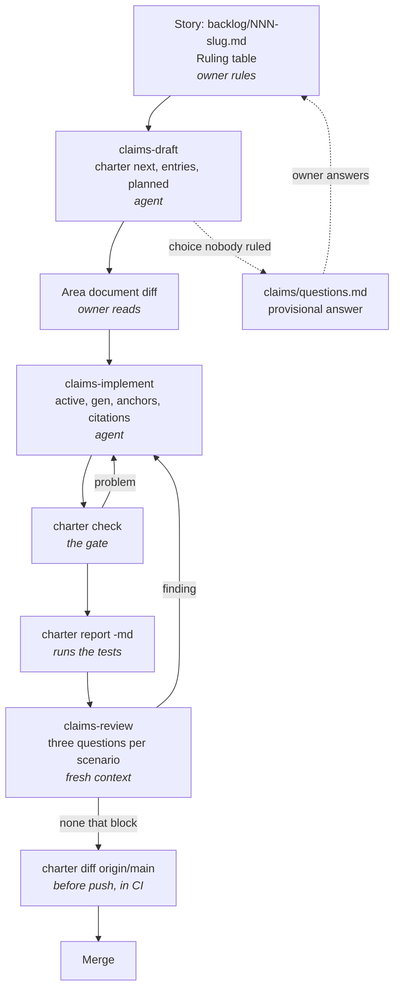

# The loop: from a story to a merged change

Every change to a charter's software goes through its record first. A
person rules what should change, an agent writes the ruling as entries, an
agent builds to those entries, a third context judges the build, and the
gate, the report and `charter diff` check what each step left. This doc
follows one change through those steps and says who does each. The
commands are the `charter` verbs; the steps an agent takes are the skills
of the `charter` plugin under `plugin/skills/`, which read the layout from
`claims/charter.toml` ([CH-261126-5JMD](../claims/adoption.md#ch-261126-5jmd-the-loops-skills-must-ship-as-a-plugin-of-this-repository-and-must-read-the-adopters-layout-from-chartertoml-alone)).



The people are the ones the record names
([needs.md](../claims/needs.md)): the owner of the record, the reviewer of
a change, the builder (a person or an agent building to a decision), and
the adopter who keeps a charter in a repository of their own.

## A story and its ruling

Work starts as a story, `backlog/NNN-slug.md`: the problem, the questions
it raises, and a `## Ruling` table with one row per question and the
owner's answer. The ruling is the draft; nothing is an entry until it is
written in an area document. The backlog's form is the skills' convention,
not a rule of the record: no entry rules it and the gate does not read it.

## Drafting the entries (claims-draft, an agent)

The claims-draft skill turns each row of the ruling into an entry, or into
a dated `Changes:` line on an entry that already rules the subject:

1. It finds the area: decisions go in `claims/<area>.md`, the document
   whose `Code:` line names the code the ruling touches; needs go in
   `claims/needs.md`. A new area is a new document, named in
   `claims/reading-order.txt` where a reader should meet it.
2. It takes the ids from the command, one per new entry:

   ```sh
   charter next CH 3
   ```

   prints three ids, one a line, each the prefix, today's UTC date and four
   characters of `BCDFGHJKMNPQRSTVWXYZ23456789`, drawn again when the tree
   or `questions.md` already holds one
   ([CH-040](../claims/anchoring.md#ch-040-one-charter-command-must-generate-check-give-ids-and-list-anchors-so-an-adopter-writes-no-main), [`Record.NewIDs`](../internal/record/ids.go#L99)).
   An id is never written by hand.
3. It writes each entry as `Status: planned`, with its text, its `Why:`, a
   scenario per clause and each scenario's provenance: `(owner, backlog
   007)` when the ruling is the owner's, `(delegate name, #12)` for a
   delegate, else `(agent, provisional)` with a question in
   `claims/questions.md` saying what it chose and why.
4. It runs `charter gen` and `charter check`. A planned entry's uncited
   scenarios are no problem; a broken form, relation or id is.
5. It stops with the area document diff for the owner, and commits
   nothing.

An entry's status is what moves it through the loop:

<!-- charter:embed CH-013 -->
> **[CH-013](../claims/intent.md#ch-013-an-entrys-status-must-be-planned-active-or-deprecated-every-status-must-generate-a-symbol-and-the-gate-must-ask-coverage-of-active-entries-only) An entry's Status MUST be planned, active or deprecated; every status MUST generate a symbol, and the gate MUST ask coverage of active entries only**
>
> - An entry's Status MUST be planned, active or deprecated; any other is a
>   form problem.
> - A planned entry is ruled but not built: its symbol MUST be generated, a
>   test MAY cite it, and the gate MUST ask nothing else of it.
> - An active entry MUST be covered.
> - A deprecated entry is retired: its symbol MUST be generated, and the
>   gate MUST ask nothing of it.
> - How the generated files mark a planned or a deprecated entry is
>   CH-020's.
<!-- /charter:embed -->

A planned entry already has its symbol, `claims.CH_…` in each language, so
a test may cite it before any code exists. An anchor may not: a
`charter:realizes` naming a planned entry fails with "set it active as its
work begins" ([CH-022](../claims/anchoring.md#ch-022-an-anchor-must-name-an-entry-that-exists-and-is-not-planned-and-a-concerns-anchor-must-not-count-toward-coverage)).

## A choice nobody ruled

When an agent must choose what the ruling does not say, it writes the
choice as a provisional scenario and a question, and goes on. The record
holds one such path in full, in the Changes of
[CH-261127-H4B7](../claims/anchoring.md#ch-261127-h4b7-charter-gen-must-keep-each-docs-references-and-embeds-current-with-the-record-and-the-code). Building backlog 007, the agent
made a doc reference whose text is the id alone stay bare when gen
rewrites it. The review of that build found the choice was the agent's,
not a ruling, so the clause got a scenario of its own, `bare-id-stays`,
provisional, and question `Q-261127-TW9H` asked the owner. The owner
answered yes; the scenario is now `(owner, Q-261127-TW9H)`, a Changes line
says so, and the answered question was deleted from `questions.md`, git
keeping it ([CH-261009-4B3B](../claims/provenance.md#ch-261009-4b3b-the-question-file-must-hold-what-nobody-has-ruled-each-question-naming-its-entry-who-asked-and-the-provisional-answer-until-it-is-answered)). While the scenario
was provisional, the report counted it among the agent's.

## Building to the entries (claims-implement, an agent)

The claims-implement skill takes the entries to covered: an anchored
declaration realizes each, a test cites each scenario, the gate is green
and the report says the tests passed.

1. It sets each entry `Status: active` (no Changes line: setting active is
   no change to the ruling) and runs `charter gen`.
2. It reads each entry's text and Why, and `charter anchors ID` for the
   code and tests already there.
3. It writes a test per scenario, first, and opens each with its citation:

   ```go
   claims.Verifies(t, claims.CH_261127_H4B7, "bare-id-stays")
   ```

   in Go; `claims.verifies(self, claims.SW_…, "handle")` in a unittest
   method or `claims.verifies(None, …)` in a pytest function; and
   `verifies(claims.SW_…, "handle")` in vitest
   ([CH-023](../claims/anchoring.md#ch-023-a-test-must-cite-an-entry-by-a-verifies-call-that-opens-a-test-function-naming-by-handle-the-scenarios-it-exercises)).
4. It anchors the declaration that carries the decision with
   `//charter:realizes CH-…` as the last line of its doc comment, `#
   charter:realizes` on the comment lines above a Python `def` or `class`,
   or a `// charter:realizes` line comment in TypeScript
   ([CH-021](../claims/anchoring.md#ch-021-production-code-must-anchor-an-entry-in-a-go-doc-comment-a-typescript-line-comment-or-the-comment-lines-above-a-python-def)).
5. A new environment variable becomes a constant of the constants module
   and goes in the owning entry's `Accounts:`; a surface now accounted for
   comes off `claims/baseline.txt` in the same change.
6. It runs `charter check` and `charter report -md`, then claims-review,
   and presents the diff, the code, the tests and the report. It commits
   nothing; the person accepts.

## The gate and the report

`charter check` fails the tree on any gap between the record and the code:
an active decision no `realizes` names, a scenario no test cites, a
surface no entry accounts for, a stale generated file, a reference in a
doc that names nothing, and the rest of the rules
([how check works](check.md)). It warns, on standard error and without
failing, of what the loop has not done yet: a planned entry whose every
scenario is cited, to set active; a deprecated entry still anchored or
cited, to strip; a doc drafted or stale
([CH-261127-QRQS](../claims/gate.md#ch-261127-qrqs-charter-check-must-warn-without-failing-of-a-planned-entry-fully-tested-a-deprecated-one-still-in-the-code-and-a-doc-to-read-again)).

The gate cannot see whether a citing test ran or passed. `charter report`
runs each language's test command with `CHARTER_EVENTS` set, joins the
outcomes to the scenarios, and exits 1 while any active scenario has no
passing test ([the report](report.md)).

## Judging the change (claims-review, a fresh context)

The claims-review skill runs in a context that did not write the change:
a new agent or a person who has not read the implementation. For each
scenario the change touched (entries added, scenarios reworded or given a
new provenance, tests or anchored code edited, and every entry `charter
diff BASE` names), it answers three questions with evidence:

1. Does the citing test show what the scenario's sentence says?
2. Does the anchored code carry the decision?
3. Does the Changes line say what changed and why?

Each no is a finding, written as a `Verdict:` line. Where the charter has
`claims/policy.md`, it says by the decision's Kind and area whether a
finding blocks or warns. The judge changes nothing; its verdicts go to the
builder, who fixes the code, the test or the entry, and to the owner.

## Before the push, and in CI

`charter diff origin/main` reads the area documents as they were at the
base and names, by id, every change to the record that no new dated
`Changes:` line states: an entry gone that was not deprecated, one made
planned again, a text, Kind or scenario changed without a line, a ruling
lost ([CH-261009-QQC8](../claims/provenance.md#ch-261009-qqc8-charter-diff-must-name-every-change-to-the-record-that-its-changes-lines-do-not-state); [diff](diff.md)). It
exits 1 when it names anything. After its findings it lists the docs whose
references changed, to read again, without changing that status.

In this repository, `make check` runs the Go tests (which include the
charter's own gate and each example's), `charter check`, and each
example's gate and report; it runs before every push.

## After the merge

- **Retiring an entry** is two changes. The first sets `Status:
  deprecated` with a Changes line naming what replaces it; its symbols
  carry a deprecation notice, and check warns of every anchor and citation
  left, to strip. A later change deletes the entry; diff accepts the
  deletion of an entry deprecated at its base.
- **claims-audit**, by hand, reads the whole record against its tests and
  code in a fresh context and writes `claims/audit.md`.
- **claims-probe** runs the probes of the observations an entry rests on,
  against the live systems, and writes the Observed date or proposes the
  observation Broken. This charter has none.
- **claims-narrate** drafts docs like this one, and proposes edits to one
  check warns is stale; a person reads it and runs
  `charter curate -by NAME FILE` ([docs](docs.md)).
