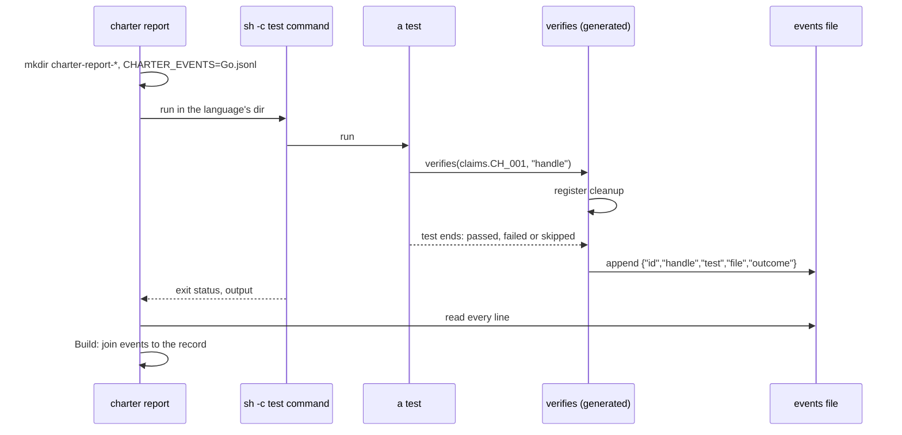

# charter report and the events file

The gate shows that every active scenario is cited by a test; it cannot
show that the test ran or passed. `charter report` closes that gap. It
runs the test command of every language charter.toml names, collects the
line each citation's marker wrote with its test's outcome, and says per
entry and per scenario which citing tests passed, failed or were skipped,
and which active scenarios no citing test passed
([CH-042](../claims/review.md#ch-042-charter-report-must-join-each-tests-markers-to-its-scenarios-and-say-which-passed-failed-were-skipped-or-have-no-test)). This doc follows one run from the
environment variable it sets to the exit status.



## Running the tests

[`Run`](../internal/report/report.go#L125) reads the record, makes a temporary
directory `charter-report-*`, and for Go, Python and TypeScript in that
order, where charter.toml has the table:

1. sets `CHARTER_EVENTS` to `<tmp>/<Language>.jsonl` in the environment of
   the language's `test` command;
2. runs the command with `sh -c` in the table's `dir`, relative to the
   root, with standard output and error captured together;
3. reads the events file the command left.

A failing test is no error: its events say `failed`. A command that
cannot start, or exits non-zero having written no line, fails the whole
report with `the Go tests (go test -count=1 ./..., in .) failed having
recorded no citation: …` and its output, and `charter report` exits 2. A
line of the file that is not an event is also an error. The temporary
directory is removed when the report ends.

## The events file

Each language's generated `verifies` appends one JSON line per handle it
names, once its test ends, to the file `CHARTER_EVENTS` names
([CH-024](../claims/anchoring.md#ch-024-each-languages-verifies-must-record-each-citation-and-its-tests-outcome-as-a-json-line-in-the-events-file)):

```json
{"id":"STK-261126-H2SW","handle":"burst-then-deny","test":"TestAQuietCallerBurstsAndTheNextIsDenied","file":"/…/cmd/ratelimit/main_test.go","outcome":"passed"}
```

A citation that names no handle writes one line without `handle`. The
outcome is `passed`, `failed` or `skipped`, read from the test runner
after the test, so a `t.Skip` after the citation records `skipped`. Each
line is written in one call to a file opened to append, so lines from
tests in parallel, or from several test binaries, stay whole. With the
variable unset the marker writes nothing and the test runs as it would
without it; that is how `go test` runs outside the report.

<!-- charter:embed CH-024 -->
> **[CH-024](../claims/anchoring.md#ch-024-each-languages-verifies-must-record-each-citation-and-its-tests-outcome-as-a-json-line-in-the-events-file) Each language's verifies MUST record each citation and its test's outcome as a JSON line in the events file**
>
> - When `CHARTER_EVENTS` names a file, the generated `verifies` of every
>   language MUST append to it, once the test ends, one JSON line per
>   citation: the id, the handle when one is named, the test, its file and
>   its outcome (passed, failed or skipped).
> - With the variable unset, it MUST record nothing, and the test runs as
>   it would otherwise.
> - Lines appended by tests running at the same time MUST each be whole.
> - A nil or missing symbol MUST be refused at run time.
> - The report reads these lines.
<!-- /charter:embed -->

## Joining the events to the record

[`Build`](../internal/report/report.go#L203) groups the events by `ID/handle`,
or by `ID` for a citation without a handle, and walks every entry of the
record:

- A scenario's outcome folds its citing tests' outcomes
  ([`outcomeOf`](../internal/report/report.go#L270)): `fail` if any failed;
  else `pass` if any passed; else `none` if any event had an outcome the
  report does not know; else `skip`. With no event at all it is `none`.
- A scenario that did not pass, with a line in `claims/waivers.txt`
  naming it and giving a reason, is `waived`.
- An active scenario whose outcome is neither `pass` nor `waived` goes in
  `Unverified`, as `ID/handle`; an active entry without scenarios, as
  `ID`. A planned or deprecated entry is reported and never unverified.
- An entry's outcome is the worst of its scenarios', in the order fail,
  none, skip, waived, pass ([`worse`](../internal/report/report.go#L291)).
- Each scenario carries its provenance as written, `owner, backlog 003` or
  `agent, provisional`, and the active ones are counted by it in the
  [`Profile`](../internal/report/report.go#L61): the owner's, a delegate's
  and an agent's provisional, each with how many passed
  ([CH-261009-3FHW](../claims/needs.md#ch-261009-3fhw-the-record-must-show-who-ruled-each-scenario-and-charter-diff-must-name-any-change-to-an-entry-the-record-does-not-state)).

## What it prints

`charter report` prints the [`Report`](../internal/report/report.go#L99) as
indented JSON, with Go's field names (`Entries`, `Unverified`, `Profile`)
and each test file as its marker wrote it (Go's marker writes an absolute
path). `charter
report -md` renders it for a pull request with
[`Report.Markdown`](../internal/report/report.go#L304): the profile sentence,
then the unverified scenarios or `Every active scenario passed.`, then a
section per entry. From `examples/ratelimit`:

```markdown
Active scenarios by who ruled them: 0 ruled by the owner (0 passed), 0 by a delegate (0 passed), 14 an agent's, provisional (14 passed).

Every active scenario passed.
## STK-261126-H2SW A caller gets a burst at once, then its sustained rate, and no more

active, pass

- `burst-then-deny` (agent, provisional): pass · TestAQuietCallerBurstsAndTheNextIsDenied (pass)
- `callers-apart` (agent, provisional): pass · TestASpentCallerDoesNotStopAnother (pass)
```

The exit status is 1 while `Unverified` holds anything, 0 otherwise, and
2 when a command or the events file failed.

## Traps

- The report does not run the gate. A citation the gate refuses, such as
  a `Verifies` after another statement, still runs and still writes its
  event, so the report counts a test the gate does not. Run check first;
  the two agree only on a tree the gate passes.
- A test that never reaches its citation writes nothing. A scenario whose
  only test the command filtered out, or whose package failed to build
  while other packages wrote events, is `none`, not `fail`.
- The TypeScript marker records through vitest's global `onTestFinished`,
  so vitest must run with `globals`, as this repository's tests do with
  `vitest run --globals`.
- Under pytest the generated `claims.py` sees outcomes through a hook,
  which runs only when the module is listed in `pytest_plugins`.
- A waived scenario passes the report today as it passes the gate: both
  read the waiver file, and `Build` leaves a waived scenario out of
  `Unverified`.
